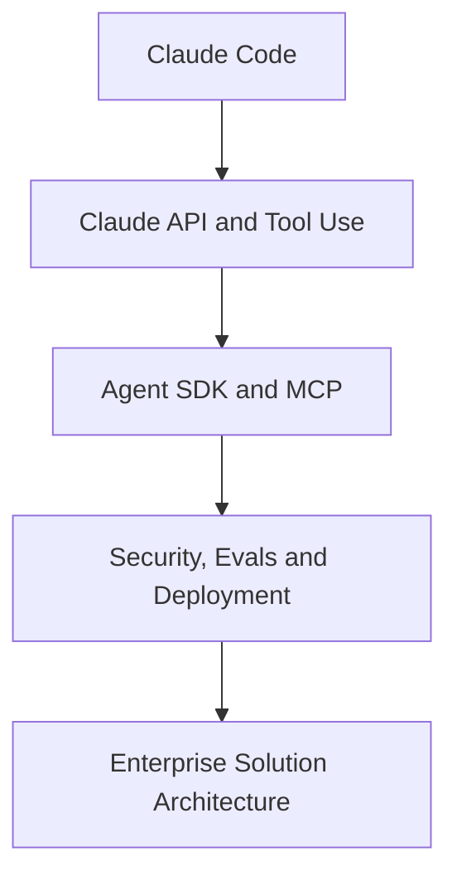

# Claude Agent Engineering — 30-Day Bootcamp

**30 天 × 5 小時 = 150 小時**，繁體中文高強度 Claude Code、Claude API、Agent SDK、MCP、Production Engineering、Enterprise Architecture 課表。

2026-10-26 — 2026-11-24 · 30% 課程 / 60% 實作 / 10% 驗收

> Independent open-source curriculum. Not affiliated with Anthropic. Do not redistribute partner-only content or exams.

## Architecture

## Daily learning plan

- [Day 01 — Claude setup](curriculum/day-01.md)
- [Day 02 — Context & CLAUDE.md](curriculum/day-02.md)
- [Day 03 — Plan mode & Git](curriculum/day-03.md)
- [Day 04 — Hooks & permissions](curriculum/day-04.md)
- [Day 05 — Skills & subagents](curriculum/day-05.md)
- [Day 06 — MCP server](curriculum/day-06.md)
- [Day 07 — Full-stack app](curriculum/day-07.md)
- [Day 08 — Messages API](curriculum/day-08.md)
- [Day 09 — Prompt & structured outputs](curriculum/day-09.md)
- [Day 10 — Tool calling](curriculum/day-10.md)
- [Day 11 — Agent SDK](curriculum/day-11.md)
- [Day 12 — MCP security](curriculum/day-12.md)
- [Day 13 — RAG & citations](curriculum/day-13.md)
- [Day 14 — Agent integration](curriculum/day-14.md)
- [Day 15 — Architecture patterns](curriculum/day-15.md)
- [Day 16 — State & approvals](curriculum/day-16.md)
- [Day 17 — Prompt injection](curriculum/day-17.md)
- [Day 18 — Evaluation](curriculum/day-18.md)
- [Day 19 — Observability & cost](curriculum/day-19.md)
- [Day 20 — CI/CD & deployment](curriculum/day-20.md)
- [Day 21 — Partner Badge](curriculum/day-21.md)
- [Day 22 — Developer exam prep](curriculum/day-22.md)
- [Day 23 — Discovery workshop](curriculum/day-23.md)
- [Day 24 — Solution architecture](curriculum/day-24.md)
- [Day 25 — AI risk & governance](curriculum/day-25.md)
- [Day 26 — ROI & delivery](curriculum/day-26.md)
- [Day 27 — Architect exam prep](curriculum/day-27.md)
- [Day 28 — Operational handover](curriculum/day-28.md)
- [Day 29 — Go-live simulation](curriculum/day-29.md)
- [Day 30 — Final client defense](curriculum/day-30.md)

## Resources

- [Courses and certifications](docs/certifications.md)
- [Capstone architecture](docs/capstone.md)
- [Progress checklist](docs/progress.md)
- [Assessment rubric](docs/assessment.md)
- [Client delivery](docs/client-delivery.md)

[Anthropic Partner Academy](https://anthropic-partners.skilljar.com/) · [Claude Academy](https://academy.claude.com/) · [Claude Code Docs](https://code.claude.com/docs/) · [Claude API](https://docs.anthropic.com/) · [MCP](https://modelcontextprotocol.io/)

MIT License.
