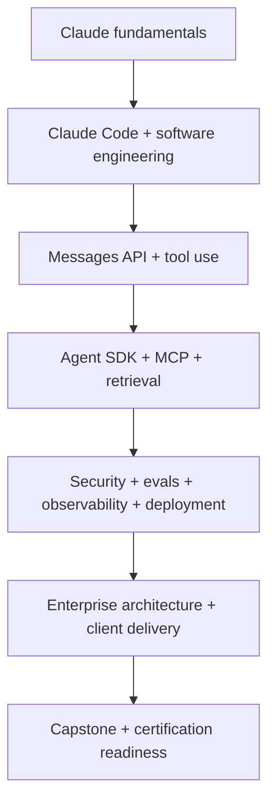

# Claude Agent Engineering — 30-Day Bootcamp

  

> A rigorous, **Traditional Chinese** 30-day, 150-hour, build-first curriculum for Claude Code, Claude API, Agent SDK, MCP, production AI engineering, and enterprise solution architecture.

**起訖日：2026-10-26 → 2026-11-24** · **每天五小時** · **30% 理論 / 60% 實作 / 10% 驗收**

本儲存庫為獨立社群學習計畫，**非 Anthropic 官方認證課程或官方背書**。課程資訊可能更新，請以 [Anthropic Partner Academy](https://anthropic-partners.skilljar.com/) 及最新官方 Exam Guide 為準。Partner Academy 資源需自行取得適當存取權限；本 Repo **不包含受權限保護的課件或考題**。

## 🎯 完成後應具備的能力

- 熟練 Claude Code 的 context、skills、subagents、hooks、permissions 與 Git workflow。
- 不依賴黑箱範例，建立 Claude API tool loop、Agent SDK 應用與 MCP server。
- 進行 evaluation、threat modeling、observability、cost control 和部署。
- 向客戶解釋架構決策、TCO/ROI、安全控制與交付路線。
- 交付一套以 **合成資料** 建立的 Enterprise Financial Research Agent。

## 🗺️ 學習路線

## 🗓️ 30 天課程入口

| 範圍 | 學習主線 | 詳細安排 |
|---|---|---|
| Day 01–07 | Claude Code Advanced Engineering | [Week 1](curriculum/week-01-claude-code.md) |
| Day 08–14 | Claude API / Agent SDK / MCP | [Week 2](curriculum/week-02-agent-sdk.md) |
| Day 15–21 | Production Engineering | [Week 3](curriculum/week-03-production.md) |
| Day 22–28 | Enterprise Architecture / Certification | [Week 4](curriculum/week-04-architecture.md) |
| Day 29–30 | Go-live / Technical Board | [Final](curriculum/final-assessment.md) |

每週頁面連結到 **每日獨立 Markdown 任務卡**，共 30 份，每份含課程、實作、交付物和通過標準。

## 📚 官方資源與考證

見 [Official Courses & Certification Map](docs/courses-and-certifications.md)。

目標包含 Claude Code 專項課程、Developer / Architect 認證準備。**認證是否可報名、考試費用、名稱與實際可考日期，以 Partner Academy／考試提供者顯示為準；本計畫不保證取得認證。**

## 🧪 Capstone

[Enterprise Financial Research & Workflow Agent](docs/capstone.md)：文件檢索、財務資料工具、來源引用、人工批准、評估、部署與監控。優先實作單 Agent，再衡量是否引入 multi-agent。

## ✅ Tracking & Acceptance

- [Daily tracker](docs/progress-tracker.md)
- [Learning log](docs/learning-log.md)
- [Rubric](docs/assessment-rubric.md)
- [Architecture & security](docs/architecture.md)
- [Client delivery](docs/client-delivery.md)

## 🚀 Getting started

1. Fork 或 clone 本 Repo，複製 [`templates/daily-note.md`](templates/daily-note.md) 當每日筆記。
2. 使用自己取得授權的 Anthropic Partner Academy，並核對最新考綱。
3. 由 [Day 01](curriculum/day-01.md) 開始，**每天提交 code / tests / architecture notes**。
4. 切勿提交 API keys、付費教材、考題、雇主或客戶的專有資料。

## License & Trademark

本專案原創學習計畫以 [MIT License](LICENSE) 開放。Anthropic、Claude、Claude Code 等名稱屬其各自權利人；本 Repo 不代表 Anthropic 官方關係。外部教材仍受各自授權約束。
