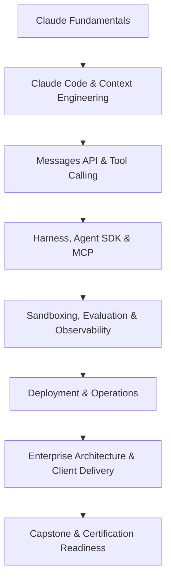

# Claude Agent Engineering — 30-Day Intensive Bootcamp

> An open-source, hands-on **30-day, 150-hour** learning roadmap for engineers and solution architects who want to progress from Claude-assisted development to designing, building, evaluating, deploying, and presenting enterprise-grade Claude AI agents.

[切換至繁體中文 / Read in Traditional Chinese](#traditional-chinese)

## 📖 Overview

This bootcamp focuses on gaining practical mastery of the Claude ecosystem, including **Claude Code, the Claude API, Agent Harness Engineering, the Claude Agent SDK, MCP, sandbox isolation, evaluation, production operations, and enterprise solution architecture**.

- **Suggested dates:** October 26 – November 24, 2026 (start any time)
- **Workload:** 5 hours per day for 30 days — 150 hours total
- **Learning split:** 30% guided learning, 60% hands-on engineering, 10% assessment
- **Core tools:** Claude Code, Claude API, Claude Agent SDK, MCP, Git, testing and deployment tooling
- **Final deliverable:** A deployable Enterprise Financial Research & Workflow Agent with technical documentation and a client-ready architecture pack
- **Certification focus:** Anthropic Partner Academy Developer and Architect training, subject to current eligibility and official exam guides

## 🧠 Learning Architecture

### Four-week roadmap

| Phase | Days | Focus | Deliverable |
|---|---|---|---|
| Week 1 | 01–07 | Claude Code, CLAUDE.md, Skills, Hooks, Permissions, Sandbox Foundations, MCP | Tested full-stack application |
| Week 2 | 08–14 | Messages API, bounded Agent Harness, tool use, Agent SDK, MCP, RAG | Tool-enabled AI agent |
| Week 3 | 15–21 | Harness state/recovery, sandbox isolation, eval harness, tracing, CI/CD | Deployable and monitored agent |
| Week 4 | 22–28 | Enterprise architecture, governance, ROI, client delivery, certification | Client-ready solution design pack |
| Final | 29–30 | Failure simulation, live demonstration, architecture review | Completed capstone |

### Integrated execution and security track

Harness, sandbox and evaluation are **taught inside the daily tasks**, not as extra weeks or appended modules: [Day 04](curriculum/day-04.md) → [Day 10](curriculum/day-10.md) → [Day 16](curriculum/day-16.md) → [Day 17](curriculum/day-17.md) → [Day 18](curriculum/day-18.md) → [Day 29](curriculum/day-29.md). The [Harness](docs/agent-harness-engineering.md), [Sandbox](docs/ai-sandbox-security.md), and [Evaluation](docs/evaluation-harness.md) documents are reference guides to those daily labs.

## 📅 Complete 30-Day Curriculum

| Day | Topic |
|---|---|
| 01 | [Claude ecosystem and environment](curriculum/day-01.md) |
| 02 | [CLAUDE.md and context engineering](curriculum/day-02.md) |
| 03 | [Plan Mode, Git, and testing](curriculum/day-03.md) |
| 04 | [Hooks, Permissions & Sandbox Foundations](curriculum/day-04.md) |
| 05 | [Skills and subagents](curriculum/day-05.md) |
| 06 | [MCP server fundamentals](curriculum/day-06.md) |
| 07 | [Full-stack week-one challenge](curriculum/day-07.md) |
| 08 | [Messages API](curriculum/day-08.md) |
| 09 | [Prompting and structured outputs](curriculum/day-09.md) |
| 10 | [Tool Calling & Agent Harness](curriculum/day-10.md) |
| 11 | [Claude Agent SDK](curriculum/day-11.md) |
| 12 | [Advanced MCP security](curriculum/day-12.md) |
| 13 | [RAG and citations](curriculum/day-13.md) |
| 14 | [Agent integration](curriculum/day-14.md) |
| 15 | [Agent architecture patterns](curriculum/day-15.md) |
| 16 | [Harness State, Checkpoints & Approvals](curriculum/day-16.md) |
| 17 | [Sandbox Isolation & Prompt Injection](curriculum/day-17.md) |
| 18 | [Evaluation Harness](curriculum/day-18.md) |
| 19 | [Observability and cost](curriculum/day-19.md) |
| 20 | [CI/CD and deployment](curriculum/day-20.md) |
| 21 | [Claude Code Partner Badge](curriculum/day-21.md) |
| 22 | [Developer certification preparation](curriculum/day-22.md) |
| 23 | [Client discovery](curriculum/day-23.md) |
| 24 | [Solution architecture](curriculum/day-24.md) |
| 25 | [AI governance and risk](curriculum/day-25.md) |
| 26 | [ROI and delivery planning](curriculum/day-26.md) |
| 27 | [Architect certification preparation](curriculum/day-27.md) |
| 28 | [Operational handover](curriculum/day-28.md) |
| 29 | [Harness + Sandbox + Eval Go-live Drill](curriculum/day-29.md) |
| 30 | [Final client architecture defense](curriculum/day-30.md) |

Each daily guide contains learning objectives, official learning resources, a five-hour schedule, hands-on engineering tasks, reflection questions, and a completion checklist.

## 🛠️ Capstone Project

Build an **Enterprise Financial Research & Workflow Agent** using public or synthetic financial data. The agent should retrieve documents, execute validated tools, analyze datasets, generate source-grounded reports, and require human approval for sensitive operations.

The solution should include API integration, Agent SDK, MCP tools, access control, evaluation, tracing, cost monitoring, deployment, rollback, and documentation.

See the [Capstone specification](docs/capstone.md).

## 🎓 Official Courses and Certification Resources

| Focus | Official resource |
|---|---|
| Claude Code, Agent Skills and Claude API learning | [Claude Academy](https://academy.claude.com/) |
| Partner training and certification preparation | [Anthropic Partner Academy](https://anthropic-partners.skilljar.com/) |
| Claude Code | [Claude Code documentation](https://code.claude.com/docs/) |
| Claude API and Agent SDK | [Anthropic documentation](https://docs.anthropic.com/) |
| Model Context Protocol | [MCP documentation](https://modelcontextprotocol.io/) |

Formal certifications differ from course completion badges. Eligibility, course availability, exam fees and specifications may change. See [Courses and certifications](docs/certifications.md).

## 🚀 Getting Started

1. Fork or clone the repository.
2. Start with [Day 01](curriculum/day-01.md) and configure your Claude development environment.
3. Complete five hours of daily training, including implementation, tests, Git commits, architecture decisions and learning notes.
4. Record progress using the [30-day checklist](docs/progress.md).
5. Use the [mastery rubric](docs/assessment.md) for weekly independent exercises and the final evaluation.

**Additional documentation:** [Client delivery pack](docs/client-delivery.md) · [Contributing](CONTRIBUTING.md) · [MIT License](LICENSE)

## ⚠️ Disclaimer and Security

This is an independent community learning project and **is not affiliated with, endorsed by, or certified by Anthropic**. Do not commit restricted Partner Academy materials, proprietary exam questions, API keys, confidential client data, or other secrets. Completing the bootcamp does not guarantee professional certification or mastery of every enterprise deployment scenario.

## 🤝 Contributing and License

Contributions, corrections, and improvements are welcome via pull requests. This repository is distributed under the [MIT License](LICENSE).

---

# Claude AI Agent 工程與架構師：30 天高強度實戰訓練

**繁體中文在下 / English above** · [Back to English](#english-version)

> 一套開源、以實作為核心的 **30 天 × 每天 5 小時（150 小時）** 學習路線，從 Claude Code、Claude API、Agent Harness、Agent SDK、MCP、Sandbox、Evaluation，一路進階到 AI Agent 的測試、部署、治理及企業級客戶交付。

## 📖 專案簡介

這個 Bootcamp 專為希望從 AI 輔助開發，進階成能**獨立設計、開發、測試、部署及向客戶展示企業級 Claude AI Agent** 的工程師與解決方案架構師設計。

- **訓練期間：** 2026 年 10 月 26 日至 11 月 24 日（可隨時自行開始）
- **總時數：** 150 小時，30 天 × 5 小時
- **學習分配：** 30% 課程與文件、60% 動手實作、10% 驗收
- **主要工具：** Claude Code、Claude API、Claude Agent SDK、MCP、Git、測試與部署工具
- **最終成果：** 可部署的 Enterprise Financial Research & Workflow Agent + 架構與客戶交付文件
- **認證方向：** Anthropic Partner Academy 的 Developer / Architect 學習與應試準備；實際資格依公司權限及當期官方考綱而定

## 🧠 學習知識架構

### 四週學習路線

| 階段 | 天數 | 技術重點 | 每週交付 |
|---|---|---|---|
| Week 1 | 01–07 | Claude Code、Skills、Hooks、Sandbox 基礎、MCP | 可測試的全端應用 |
| Week 2 | 08–14 | Messages API、Agent Harness、Tool Calling、Agent SDK、RAG | 能使用工具的 AI Agent |
| Week 3 | 15–21 | Harness 恢復、Sandbox 隔離、Evaluation Harness、CI/CD | 可部署、可監控的 Agent |
| Week 4 | 22–28 | Enterprise Architecture、Governance、ROI、客戶交付、認證 | 客戶級 Solution Design Pack |
| Final | 29–30 | 故障模擬、正式 Demo、Architecture Review | 完整實戰 Capstone |

### Harness、Sandbox 與 Evaluation 融合式學習

這三個主題已經**直接排入每日課表**，不再另外附加： [Day 04](curriculum/day-04.md) → [Day 10](curriculum/day-10.md) → [Day 16](curriculum/day-16.md) → [Day 17](curriculum/day-17.md) → [Day 18](curriculum/day-18.md) → [Day 29](curriculum/day-29.md)。[Harness](docs/agent-harness-engineering.md)、[Sandbox](docs/ai-sandbox-security.md)、[Evaluation](docs/evaluation-harness.md) 三份文件保留為每天實作時使用的深入參考資料。

## 📅 完整 30 天課表

| Day | 主題 |
|---|---|
| 01 | [Claude 生態系與開發環境](curriculum/day-01.md) |
| 02 | [CLAUDE.md 與 Context Engineering](curriculum/day-02.md) |
| 03 | [Plan Mode、Git 與測試](curriculum/day-03.md) |
| 04 | [Hooks、Permissions 與 Sandbox 基礎](curriculum/day-04.md) |
| 05 | [Skills 與 Subagents](curriculum/day-05.md) |
| 06 | [MCP Server 基礎](curriculum/day-06.md) |
| 07 | [全端應用週考核](curriculum/day-07.md) |
| 08 | [Messages API](curriculum/day-08.md) |
| 09 | [Prompt 與結構化輸出](curriculum/day-09.md) |
| 10 | [Tool Calling 與 Agent Harness](curriculum/day-10.md) |
| 11 | [Claude Agent SDK](curriculum/day-11.md) |
| 12 | [MCP 安全與進階應用](curriculum/day-12.md) |
| 13 | [RAG 與來源引用](curriculum/day-13.md) |
| 14 | [Agent 整合](curriculum/day-14.md) |
| 15 | [Agent 架構模式](curriculum/day-15.md) |
| 16 | [Harness State、Checkpoint 與人工審核](curriculum/day-16.md) |
| 17 | [Sandbox 隔離與 Prompt Injection](curriculum/day-17.md) |
| 18 | [Evaluation Harness](curriculum/day-18.md) |
| 19 | [Observability 與成本](curriculum/day-19.md) |
| 20 | [CI/CD 與部署](curriculum/day-20.md) |
| 21 | [Claude Code Partner Badge](curriculum/day-21.md) |
| 22 | [Developer 認證準備](curriculum/day-22.md) |
| 23 | [客戶需求訪談](curriculum/day-23.md) |
| 24 | [Solution Architecture](curriculum/day-24.md) |
| 25 | [AI 治理與風險](curriculum/day-25.md) |
| 26 | [ROI 與交付計畫](curriculum/day-26.md) |
| 27 | [Architect 認證準備](curriculum/day-27.md) |
| 28 | [營運交接](curriculum/day-28.md) |
| 29 | [Harness + Sandbox + Eval 上線演練](curriculum/day-29.md) |
| 30 | [最終客戶架構答辯](curriculum/day-30.md) |

每份每日文件都包含：學習目標、指定資源、五小時時間分配、動手實作、深度理解問題及驗收 Checklist。

## 🛠️ Capstone 專案

**Enterprise Financial Research & Workflow Agent**：運用公開或合成財務資料，讓 Agent 能夠檢索文件、呼叫工具、分析資料、產生具引用來源的報告，並對敏感操作要求人工核准。

最終需涵蓋 API、Agent SDK、MCP、資料存取、權限、Evaluation、Tracing、成本監控、部署、Rollback 和文件交付。

詳見 [Capstone 專案規格](docs/capstone.md)。

## 🎓 課程、認證與官方資源

| 學習領域 | 官方入口 |
|---|---|
| Claude Code、Agent Skills、Claude API 課程 | [Claude Academy](https://academy.claude.com/) |
| Partner 課程與認證準備 | [Anthropic Partner Academy](https://anthropic-partners.skilljar.com/) |
| Claude Code 技術文件 | [Claude Code Docs](https://code.claude.com/docs/) |
| Claude API 與 Agent SDK | [Anthropic Documentation](https://docs.anthropic.com/) |
| Model Context Protocol | [MCP Documentation](https://modelcontextprotocol.io/) |

正式認證與課程完成 Badge 不同；課程、資格、費用與考試安排可能變更。詳見 [課程與認證指南](docs/certifications.md)。

## 🚀 如何開始

1. Fork 或 Clone 這個 Repo。
2. 閱讀 [Day 01](curriculum/day-01.md)，配置 Claude Code 及開發環境。
3. 每天完成五小時訓練，提交 Git Commit、測試結果、技術決策與學習筆記。
4. 使用 [進度追蹤 Checklist](docs/progress.md) 記錄成果。
5. 依照 [驗收標準](docs/assessment.md) 進行每週閉卷實作與最終考核。

**其他文件：** [客戶交付指南](docs/client-delivery.md) · [貢獻指南](CONTRIBUTING.md) · [MIT License](LICENSE)

## ⚠️ 開源及安全說明

這是獨立的社群學習計畫，**並非 Anthropic 官方教材、官方認證或官方背書**。請不要公開公司內部的 Partner Academy 專屬課程、考題、API Keys、客戶資料或其他機密資訊。30 天是高強度的能力建立目標，而非保證成為大型企業部署專家的期限。

---
