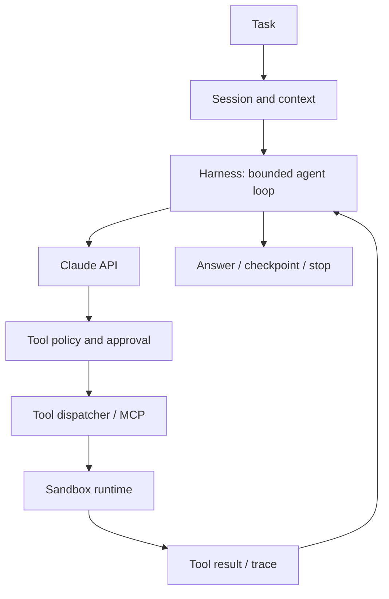

# Agent Harness Engineering｜Agent 執行框架實戰

[README](../README.md) · [Sandbox](ai-sandbox-security.md) · [Eval Harness](evaluation-harness.md)

## What is an Agent Harness?

Model 負責提出下一步，**Harness** 負責組織 Session、Context、工具路由、權限、狀態、重試、停止條件與持久化。不要混淆 Harness、Agent SDK、MCP 和 Sandbox：

- **Claude model:** reasoning + tool requests
- **Agent harness:** run loop, tool dispatch, budgets, policies, traces
- **Claude Agent SDK:** libraries and capabilities to implement or use a harness
- **MCP:** tool integration protocol, not a security boundary
- **Sandbox:** isolated runtime in which selected tools/code run
- **Eval harness:** reproducible environment + graders + reporting

## Architecture

## Labs — ~10 hours (integrated into Day 10, 11, 15, 16, 19)

1. **Loop from scratch:** implement max_steps and max_cost_usd controls; allowlist tools and validate schemas; defend against malformed model tool requests.
2. **Session manager:** persisted sessions, summarization, checkpoint and resume across process restarts; never blindly rerun consequential tools.
3. **Reliable execution:** timeouts, cancellation, retries with exponential backoff, idempotency keys and deterministic stopping.
4. **Comparative architecture:** hand-written Messages API harness vs Claude Agent SDK vs managed runtime; measure time, cost and failure rate.
5. **Observability:** emit trace IDs, model/tool events, permissions decisions, task outcomes and tokens.

## Harness acceptance tests

- [ ] Infinite-loop prevention; max-step, max-time and max-spend policies
- [ ] Denied tool call cannot be run by a fallback path
- [ ] Interrupted session resumes without repeating a high-risk action
- [ ] Tool errors and malformed outputs are handled predictably
- [ ] Trace links model actions to tool effects and final outcomes
- [ ] Evaluate single-agent vs multi-agent only where data supports added complexity

## Official references

- [Effective harnesses for long-running agents](https://www.anthropic.com/engineering/effective-harnesses-for-long-running-agents)
- [Scaling Managed Agents](https://www.anthropic.com/research/managed-agents)
- [Claude Agent SDK](https://platform.claude.com/docs/en/agent-sdk/overview)

> Always follow the current documentation and do not embed Partner Academy copyrighted course contents.
