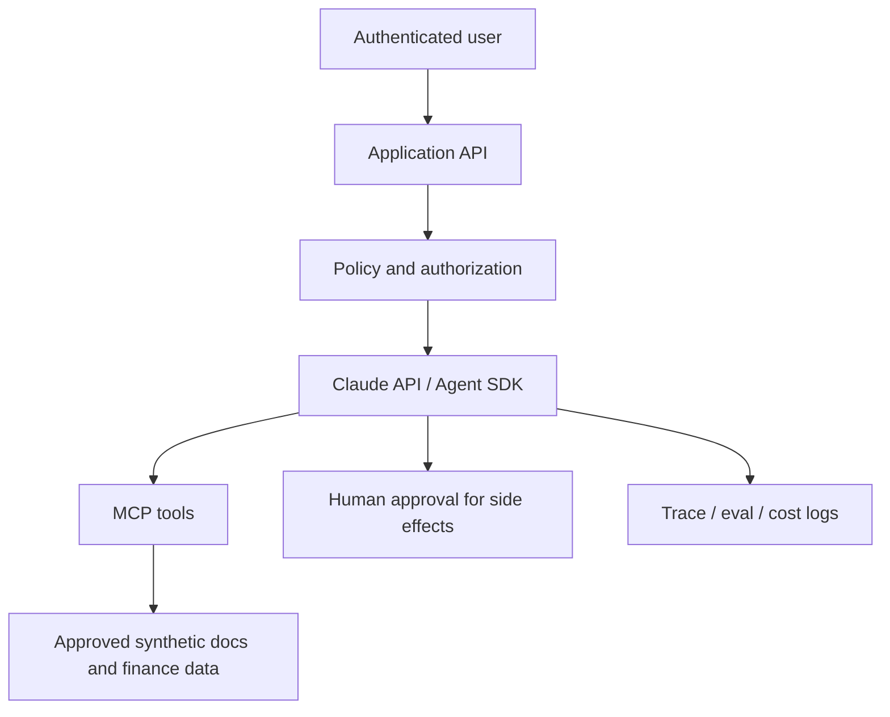

# Architecture & Security Checklist

## Architecture decisions

- Messages API vs Agent SDK vs managed execution: 依自主程度、部署控制、工具權限、運行負擔選擇。
- 單 Agent vs 多 Agent：先測單 Agent baseline 的任務成功率、token/latency，再決定。
- Tools vs MCP：MCP 是標準化整合途徑，不是所有工具都必須透過 MCP。
- Retrieval vs Agent：純問答優先考慮簡單 retrieval pipeline。

## Security

- [ ] 後端託管 secrets，不放在程式或 client bundle
- [ ] 每次工具執行前的伺服器授權，不只靠 prompt
- [ ] 不可信資料與指令隔離，測試 prompt injection
- [ ] 記錄與遮罩敏感資料
- [ ] 具副作用的工具加入 human approval
- [ ] timeout / retry / budget limits / audit log
