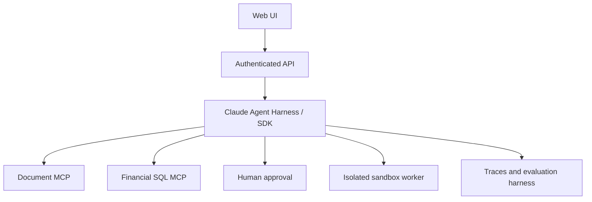

# Enterprise Financial Research & Workflow Agent

Use synthetic/public financial data only.

- Week 1: Full-stack app and Claude Code engineering.
- Week 2: Bounded harness and tool loop, Agent SDK, MCP, retrieval and citations.
- Week 3: Checkpoints, sandbox isolation, >=50 evaluation cases, approvals, tracing and deployment.
- Week 4: HLD, ADR, TCO, client presentation and handover.

Definition of done: validated tools, server-side authorization, citations, regression evaluation, trace IDs, cost/latency, CI/CD, rollback and reproducible demo.

---

# Capstone：企業金融研究與工作流 Agent

僅使用合成或公開財務資料。第一週完成全端應用與測試；第二週整合 Claude API、有界 Agent Harness、Agent SDK、MCP 與文件引用；第三週加入 Checkpoint、Sandbox 隔離、人工核准、至少 50 個 Eval、追蹤及部署；第四週完成架構圖、技術決策、TCO、客戶簡報與交接。

完成條件：工具輸入驗證、伺服器端授權、來源引用、回歸測試、Trace ID、成本延遲監控、CI/CD、Rollback 及可重現 Demo。
