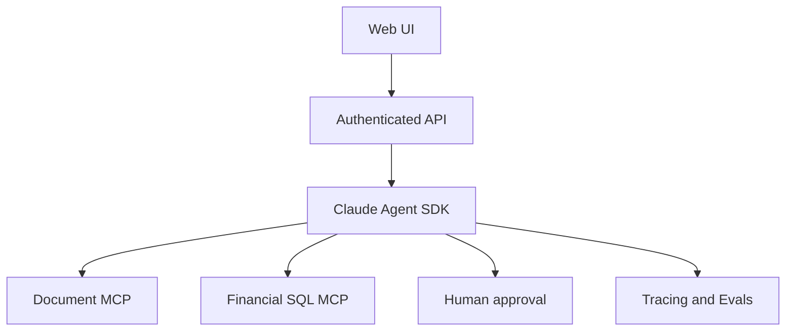

# Enterprise Financial Research & Workflow Agent

Use synthetic/public financial data only.

- Week 1: Full-stack app and Claude Code engineering.
- Week 2: Messages API, Agent SDK, MCP, retrieval and citations.
- Week 3: >=50 eval cases, approval gates, security, monitoring and deployment.
- Week 4: HLD, ADR, TCO, client presentation and handover.

Definition of done: validated tools, server-side authorization, citations, regression evaluation, trace IDs, cost/latency, CI/CD, rollback and reproducible demo.
