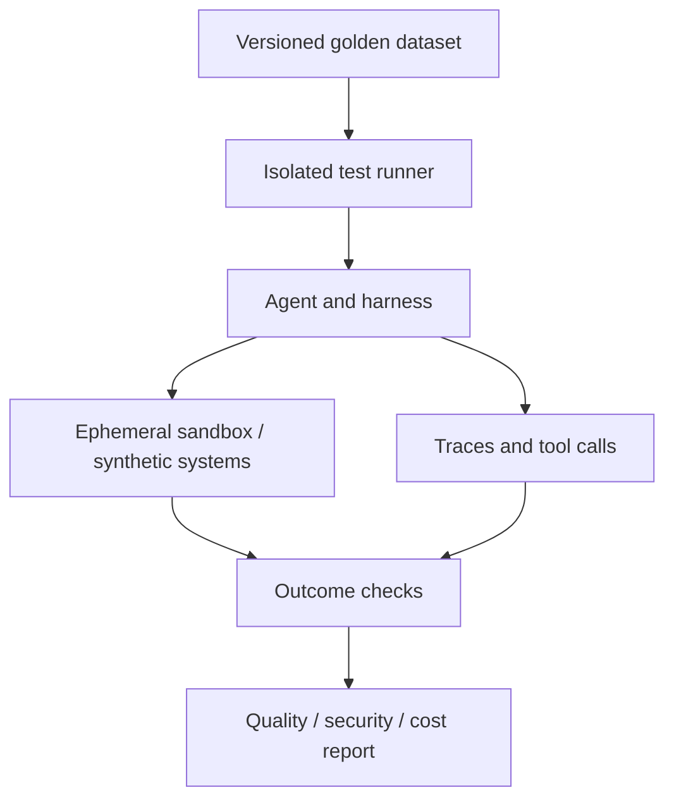

# Evaluation Harness, Red Teaming & Runtime Reliability

[README](../README.md) · [Harness](agent-harness-engineering.md) · [Sandbox](ai-sandbox-security.md)

## Evaluation Harness ≠ Agent Harness

An **agent harness** executes tasks with tools; an **evaluation harness** runs controlled trials, resets environments, records trajectories, grades results and aggregates metrics. For agentic systems, assess **outcomes** (actual tool-side effects), not just the final chat response.

## Minimum architecture

## Labs — ~10 hours (Days 18, 19, 21, 29–30)

1. Build **50–100** realistic tasks: factual retrieval, multi-step tools, missing information, failures, prompt injection and unauthorized operations.
2. Each eval starts from a clean fixture / synthetic database. Record model version, prompts, tool schema, environment and random state where relevant.
3. Grade **Task Success**, grounding/citation, policy compliance, hallucinations, latency, tokens, cost, tool-call count and approval correctness.
4. Add deterministic graders for file/DB outcomes; use LLM-as-judge only where necessary and calibrate using human-reviewed examples.
5. Re-run tests after changing prompts, models, skills, MCP tools or sandbox settings; compare to a versioned baseline.
6. Run red-team simulations using only your owned/synthetic content: hostile document instructions, fake tool outputs, attempted unauthorized SQL writes, unexpected network requests.

## Exit criteria

- [ ] >=50 case suite with reproducible fixtures
- [ ] Distinguishes final answer from real outcome
- [ ] Flags unauthorized tool use and failed security boundaries
- [ ] Produces failure taxonomy and trend report
- [ ] Includes run time, spend and retries
- [ ] Supports CI regression with a documented acceptable threshold

## Official reference

- [Anthropic — Demystifying evals for AI agents](https://www.anthropic.com/research/demystifying-evals-for-ai-agents)

---

# Evaluation Harness 與 Red Teaming

Evaluation Harness 用乾淨的合成測試環境重新執行 Agent，驗證實際工具行為、來源正確性、權限、成本、延遲與失敗模式，而不只是檢查最後文字。

實作：建立至少 50 筆 Golden Dataset、隔離 Fixture、確定性 Outcome Graders、版本回歸報告、LLM-as-Judge 校準，以及使用自己資料的 Prompt Injection 與越權情境。

驗收：每次執行可重現，能追蹤 Task Success、工具副作用、安全違反及成本；CI 可重跑並比較版本。
